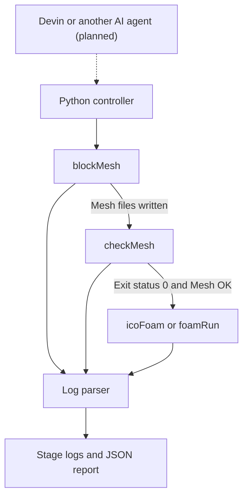

# AI-Mesh-Automation

## Project Overview

AI-Mesh-Automation is a small CFD automation prototype for an undergraduate mechanical engineering project. The Python controller generates and checks a lid-driven cavity mesh, runs a serial OpenFOAM solve, and records the outcome in JSON. OpenFOAM computes the pressure and velocity fields.

## Motivation

Meshing, mesh checks, and solver log inspection repeat with every CFD run. A consistent execution sequence and a machine-readable report give a person or a future AI agent the evidence needed to decide what to inspect when a run fails.

## System Architecture



The controller checks the reference inputs and executables before staging a fresh case under `runs/`. It records the OpenFOAM version from the activated environment or the executable banner. The solver stage requires a successful mesh check and verifies the solver's `End` marker and the final pressure and velocity files.

## Technology Stack

- Python 3.10 or later with the standard library.
- OpenFOAM with `blockMesh`, `checkMesh` and one of the supported solver commands on `PATH`.
- Plain-text OpenFOAM stage logs and a versioned JSON execution report.

| Solver path | Case configuration |
| --- | --- |
| `icoFoam` | Classic transient laminar solver with PISO. The staged case provides `transportProperties` for OpenCFD and `physicalProperties` for Foundation releases such as v10. |
| `foamRun -solver incompressibleFluid` | Foundation modular solver with laminar momentum transport and one PIMPLE outer correction. The staged case supplies `physicalProperties` and `momentumTransport`. |

See the upstream documentation for the available installation methods and solver interfaces. [OpenCFD downloads](https://www.openfoam.com/download/), [OpenFOAM Foundation downloads](https://openfoam.org/download/), [Foundation foamRun source](https://cpp.openfoam.org/v13/foamRun_8C.html).

## Project Scope

The MVP runs the bundled cavity case in serial and stops at the first failed stage. It identifies missing files and executables, fatal OpenFOAM messages, mesh check failures, abnormal solver exits, explicit divergence messages, floating-point exceptions, and invalid numbers in recognized solver lines. It reports the relevant evidence and a suggested manual check.

Every attempt stages regular files from a fixed repository-relative template and uses project-local logs, temporary paths and OpenFOAM job metadata. The solver runs with function objects disabled. The controller expects trusted OpenFOAM executables and the bundled dictionaries. The subprocesses run under the caller's OS permissions.

## Quick Start

Activate your OpenFOAM environment, then run these commands from the repository root. A standard Foundation v13 installation on Ubuntu provides `/opt/openfoam13/etc/bashrc` to source in Bash. On native Windows, put the OpenFOAM executables on `PATH` using the distribution's launcher and use `py -3` if needed.

```bash
python3 run_case.py --help
python3 run_case.py
python3 -m unittest discover -s tests -v
```

By default, solver selection prefers `icoFoam` and uses `foamRun` when `icoFoam` is absent. Set `--solver icoFoam` or `--solver foamRun` to select explicitly. `--timeout SECONDS` sets a per-stage limit from 1 to 3600 seconds, with a default of 120. `--retries` accepts 0, 1, or 2 and defaults to 0. A retry is available after a timed-out stage terminates and starts again from a fresh copy of the case.

The CLI prints the path to `runs/run-*/report.json`. Exit status 0 indicates a pass, 1 indicates an execution or reporting failure, and 2 indicates invalid CLI arguments. A writable project directory is required to record even a preflight failure.

| Report data | Location |
| --- | --- |
| Version, executable availability and selected solver | `openfoam` |
| Preflight failures and suggested checks | `diagnostics` |
| Stage arguments, exit status, duration and log paths | `attempts[].stages[]` |
| Mesh verdict, reported metrics and up to five problem excerpts | `attempts[].stages[].mesh` on the mesh check |
| Last reported simulation time and per-field residual summary when available | `attempts[].stages[].solver` on the solve |

Report log paths are relative to the report directory. The solver writes final fields to `attempt-*/case/0.5/`. Local runs are ignored by Git because the raw logs can contain hostnames and filesystem paths.

## Demonstration Case

The reference case uses the official lid-driven cavity geometry and laminar setup. It models a 0.1 m × 0.1 m square with a structured 20 × 20 × 1 mesh. The top wall moves at 1 m/s, the other in-plane walls are stationary, and the thin front and back patches use `empty` boundary conditions. The flow starts from rest with a kinematic viscosity of 0.01 m²/s, giving a Reynolds number of 10. With a time step of 0.005 s the demo runs to 0.5 s in 100 steps. The reported residuals describe individual linear solves.

The Foundation modular tutorial also supplies a cavity geometry and modular dictionaries. This project uses the classic laminar parameters for both executable paths. [OpenCFD lid-driven cavity tutorial](https://www.openfoam.com/documentation/tutorial-guide/2-incompressible-flow/2.1-lid-driven-cavity-flow), [Foundation v10 reference case](https://github.com/OpenFOAM/OpenFOAM-10/tree/master/tutorials/incompressible/icoFoam/cavity/cavity), [Foundation v13 modular reference case](https://github.com/OpenFOAM/OpenFOAM-13/tree/master/tutorials/incompressibleFluid/cavity).

## Current Status

- **Implemented** Stage execution, the mesh quality gate, per-attempt logs, JSON reporting, solver selection, and basic failure diagnosis.
- **Verified** OpenCFD OpenFOAM v2512 completed the case on Windows using `icoFoam`. The [validation record](docs/validation.md) includes real failure cases and the coverage of the Python tests.
- **In development** Broader compatibility testing across OpenFOAM builds and distributions.
- **Planned** Calling the controller from an agent and using its structured diagnostics as input to that agent.

## Future Roadmap

1. Verify additional OpenFOAM releases and publish a compatibility matrix.
2. Add numerical comparison against a cavity benchmark and test grid refinement.
3. Build a Devin or Poke adapter that invokes the CLI and reads its report.

The repository is licensed under [GPL-3.0-or-later](LICENSE).
